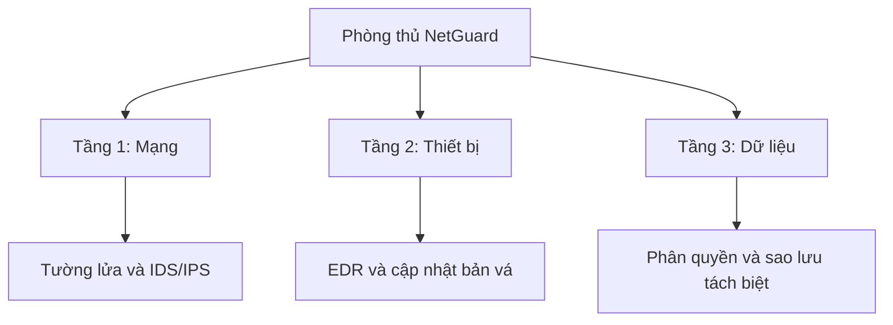

# Bài 5. Chuẩn hóa quy trình báo cáo sự cố an ninh mạng NetGuard

Báo cáo cần giúp khách hàng biết sự cố xảy ra ở đâu, đã xử lý đến bước nào và cần làm gì tiếp theo. Bài làm dưới đây sử dụng tình huống giả định, trình bày nội dung Word, Excel và PowerPoint trong một file Markdown theo yêu cầu.

## Phần 1. Phân tích: AutoFilter là “Google Search của bảng tính”

AutoFilter giúp tìm nhanh các bản ghi cần xem trong một bảng lớn. Chẳng hạn, với hàng nghìn cảnh báo, nhân viên NetGuard có thể tìm “Ransomware” trong cột loại mã độc, rồi lọc tiếp theo thiết bị hoặc trạng thái xử lý.

Cách thực hiện: chọn bảng có tiêu đề → **Data → Filter** → mở mũi tên ở cột cần tìm → nhập từ khóa hoặc chọn điều kiện lọc. Excel chỉ hiển thị các hàng đáp ứng điều kiện và tạm ẩn các hàng còn lại, không xóa dữ liệu. Bộ lọc trên nhiều cột được kết hợp theo điều kiện AND.

Cách gọi “Google Search của bảng tính” giúp hình dung thao tác tìm kiếm, nhưng AutoFilter chỉ tìm trong dữ liệu hiện có. **AutoFilter chọn ra các dòng cần xem; VLOOKUP lấy thông tin tương ứng từ bảng khác.** Với NetGuard, VLOOKUP bổ sung loại mã độc và mức độ cảnh báo, sau đó AutoFilter giúp ưu tiên các trường hợp cần xử lý.

## Phần 2. Triển khai báo cáo NetGuard

### 2.1. Excel — Nối nhật ký với cơ sở dữ liệu virus

Workbook dự kiến: `NetGuard_DoiChieuCanhBao.xlsx`, gồm hai sheet. Mỗi hàng là một bản ghi, không gộp ô hoặc để hàng trống giữa dữ liệu. Mã tra cứu lưu dạng Text; mã trong danh mục phải sạch và duy nhất.

**Sheet `CoSoDuLieuVirus`, vùng A1:D4:**

| A — Mã | B — Loại mã độc | C — Mức độ mặc định | D — Hướng xử lý ban đầu |
|---|---|---|---|
| MD001 | Trojan | Cao | Cô lập máy, kiểm tra tiến trình |
| MD002 | Ransomware | Nghiêm trọng | Cô lập máy, bảo vệ bản sao lưu |
| MD003 | Spyware | Cao | Kiểm tra truy cập và dữ liệu có nguy cơ lộ |

Đây là mã nội bộ minh họa. Kết quả ánh xạ chỉ phân loại cảnh báo, không tự chứng minh thiết bị đã nhiễm mã độc; mức độ sự cố thực tế cần được đánh giá thêm.

**Sheet `NhatKyHeThong`, dữ liệu đầu vào A1:D4:**

| A — Thời gian | B — Mã cảnh báo thô | C — Thiết bị | D — Trạng thái hiện tại |
|---|---|---|---|
| 2026-09-14 09:10 | MD002 | PC07 | Đã cô lập |
| 2026-09-14 09:12 | MD001 | PC02 | Đang phân tích |
| 2026-09-14 09:15 | MD999 | SRV01 | Chưa phân loại |

Để thử dữ liệu có khoảng trắng, nhập B2 thành `" MD002 "`, không nhập hai dấu ngoặc kép. Các cột E, F, G lần lượt là **Loại mã độc, Mức độ mặc định, Hướng xử lý**.

Nhập công thức ở hàng 2 và sao chép xuống hàng 4:

```excel
E2: =VLOOKUP(TRIM(B2),CoSoDuLieuVirus!$A$2:$D$4,2,FALSE)
F2: =VLOOKUP(TRIM(B2),CoSoDuLieuVirus!$A$2:$D$4,3,FALSE)
G2: =VLOOKUP(TRIM(B2),CoSoDuLieuVirus!$A$2:$D$4,4,FALSE)
```

**TRIM bọc trực tiếp giá trị tra cứu B2**, loại bỏ khoảng trắng thừa trước khi VLOOKUP tìm mã. `FALSE` yêu cầu khớp chính xác; `$` cố định vùng danh mục. Chỉ đặt TRIM bên ngoài toàn bộ VLOOKUP sẽ không làm sạch mã đầu vào.

Kết quả kỳ vọng: PC07 được ánh xạ thành Ransomware, PC02 thành Trojan; MD999 trả về `#N/A` vì chưa có trong danh mục. Giữ trường hợp này để xác minh, không đổi thành “An toàn”. Nếu nguồn chứa khoảng trắng đặc biệt, có thể thay `TRIM(B2)` bằng `TRIM(SUBSTITUTE(B2,CHAR(160)," "))`.

Khi danh mục dài lên, phải mở rộng vùng tra cứu hoặc dùng tham chiếu Excel Table. Nếu Excel dùng dấu chấm phẩy để phân cách đối số, thay dấu phẩy trong công thức bằng dấu chấm phẩy.

### 2.2. Word — Báo cáo sự cố và mục lục tự động

File dự kiến: `NetGuard_Incident_Report.docx`. Dùng **Title** cho tên báo cáo, **Heading 1** cho các mục 1–5 dưới đây và **Heading 2** cho mục 3.1–3.2. Các tiêu đề đặt trong phần thân tài liệu, không đặt trong hộp văn bản.

Bật **View → Navigation Pane → Headings** để xem cấu trúc, chuyển nhanh đến từng phần và kiểm tra phân cấp. Chỉ tô đậm hoặc tăng cỡ chữ sẽ không thay thế Heading Styles.

Chèn mục lục bằng **References → Table of Contents → Custom Table of Contents**, hiển thị 2 cấp và bật liên kết đến tiêu đề. Khi thêm nội dung hoặc thay đổi bố cục, chọn **Update Table → Update entire table** trước khi xuất PDF hoặc gửi khách hàng. Nhờ lấy dữ liệu từ Heading và số trang thực tế, mục lục vẫn cập nhật đúng khi báo cáo dài hàng chục trang. Không gõ tay số trang hoặc cho rằng mục lục luôn tự cập nhật ngay khi đang soạn.

#### 1. Thông tin và tóm tắt sự cố

**Mã báo cáo:** NG-IR-2026-001.  
**Thời điểm cập nhật:** 09:40 ngày 14/09/2026.  
**Đơn vị xử lý:** Trung tâm an ninh mạng NetGuard.  
**Trạng thái:** Đã cô lập PC07, tiếp tục điều tra.

Trong khoảng 09:10–09:15, hệ thống ghi nhận ba cảnh báo trên PC07, PC02 và SRV01. Hai mã đã có định nghĩa; một mã chưa xác định. PC07 được ưu tiên vì cảnh báo thuộc nhóm Ransomware. Chưa đủ bằng chứng kết luận dữ liệu đã bị mã hóa, bị lấy cắp hoặc ba cảnh báo có cùng nguồn gây ra.

#### 2. Diễn biến xử lý

| Thời điểm | Diễn biến |
|---|---|
| 09:10 | Ghi nhận cảnh báo MD002 trên PC07 |
| 09:12–09:15 | Ghi nhận thêm MD001 trên PC02 và MD999 trên SRV01 |
| 09:20 | Cô lập kết nối mạng của PC07; giữ máy hoạt động để phục vụ thu thập bằng chứng |
| 09:30 | Lưu nhật ký và thông tin tiến trình của PC07 để phân tích |
| 09:40 | Cập nhật báo cáo; tiếp tục kiểm tra PC02 và xác minh MD999 |

#### 3. Phân tích và đánh giá ảnh hưởng

**3.1. Bằng chứng ghi nhận**

Hồ sơ gồm nhật ký cảnh báo, thời gian phát hiện, tên thiết bị và dữ liệu tiến trình đã thu thập. Bản gốc được lưu riêng, giới hạn quyền truy cập và ghi nhận người thu thập. Báo cáo khách hàng không chứa mật khẩu hay thông tin xác thực.

**3.2. Nguyên nhân và phạm vi ảnh hưởng**

Nguyên nhân xâm nhập chưa được xác nhận. Cần kiểm tra lịch sử đăng nhập, tệp được thực thi và kết nối mạng liên quan. Hiện PC07 bị gián đoạn kết nối do biện pháp cô lập; chưa xác định được thiệt hại dữ liệu hoặc ảnh hưởng tới dịch vụ trên SRV01.

#### 4. Ứng phó và điều kiện khôi phục

NetGuard đã cô lập PC07 và lưu bằng chứng ban đầu. Nhóm phân tích tiếp tục xác minh cảnh báo, kiểm tra dấu hiệu lan truyền và đề xuất xử lý theo kết quả thực tế.

Chỉ kết nối lại PC07 sau khi xử lý nguyên nhân, kiểm tra an toàn và được người phụ trách phê duyệt. Nếu cần phục hồi dữ liệu, phải kiểm tra bản sao lưu trước khi sử dụng. Tại thời điểm lập báo cáo, chưa đủ điều kiện đóng sự cố.

#### 5. Kiến nghị và trách nhiệm

- **Nhóm phân tích NetGuard:** Xác minh MD999 và hoàn thiện bằng chứng trong 24 giờ tiếp theo.
- **Quản trị hệ thống:** Kiểm tra bản vá, quyền truy cập và khả năng khôi phục từ bản sao lưu.
- **Trưởng nhóm ứng cứu:** Theo dõi tiến độ, cập nhật khách hàng khi có thay đổi đáng kể và phê duyệt việc kết thúc xử lý.

### 2.3. PowerPoint — Chiến lược phòng thủ 3 tầng

File dự kiến: `NetGuard_PhongThu3Tang.pptx`. Dùng **Inter hoặc Montserrat**, tuyệt đối không dùng Times New Roman. Chọn tiêu đề khoảng 36–40 pt, nội dung 28–32 pt, nền và chữ có độ tương phản rõ để đọc được khi chiếu.

Thiết kế bài trình bày 4 slide:

| Slide | Nội dung chính | Cách thể hiện |
|---|---|---|
| 1 | PC07 đã được cô lập, sự cố vẫn đang điều tra | Dòng thời gian phát hiện và xử lý |
| 2 | Hai cảnh báo đã có định nghĩa, một cảnh báo cần xác minh | Biểu đồ thanh: 2 đã ánh xạ, 1 chưa xác định |
| 3 | NetGuard phòng thủ theo ba tầng mạng, thiết bị và dữ liệu | Sơ đồ phân cấp |
| 4 | Chỉ khôi phục sau khi kiểm tra an toàn và được phê duyệt | Luồng xử lý → kiểm tra → phê duyệt → khôi phục |

Sơ đồ cho slide 3:



Trong PowerPoint, dựng sơ đồ bằng **Insert → SmartArt → Hierarchy**. Tầng mạng kiểm soát kết nối và phát hiện truy cập bất thường; tầng thiết bị giám sát hành vi, hỗ trợ cô lập máy; tầng dữ liệu giới hạn quyền truy cập và giúp phục hồi khi cần. Ba tầng bổ sung cho nhau, cùng cung cấp thông tin để nhóm vận hành theo dõi sự cố.

### 2.4. Kiểm tra trước khi bàn giao

- **Excel:** Mã có khoảng trắng vẫn tra cứu đúng; MD999 được nhận diện là thiếu định nghĩa; lọc “Ransomware” chỉ hiển thị PC07 trong mẫu.
- **Word:** Navigation Pane hiển thị đúng cấp; thêm một trang rồi cập nhật toàn bộ mục lục, kiểm tra số trang và liên kết đến tiêu đề.
- **PowerPoint:** Sơ đồ thể hiện đủ ba tầng; kiểm tra cả Slide Master, biểu đồ và SmartArt đều dùng Inter hoặc Montserrat, không còn Times New Roman.

Các bước trên là tiêu chí kiểm tra khi dựng bộ file Office; bản Markdown cung cấp nội dung và thiết kế, không chứa mục lục Word hay công thức Excel đang chạy.
